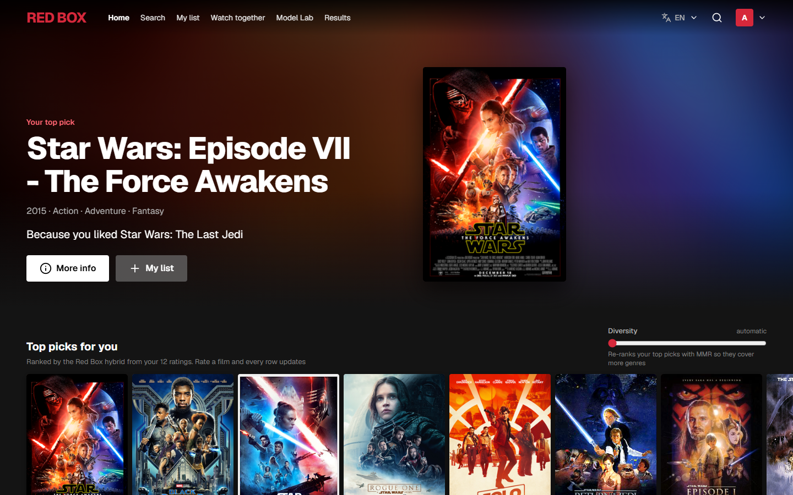
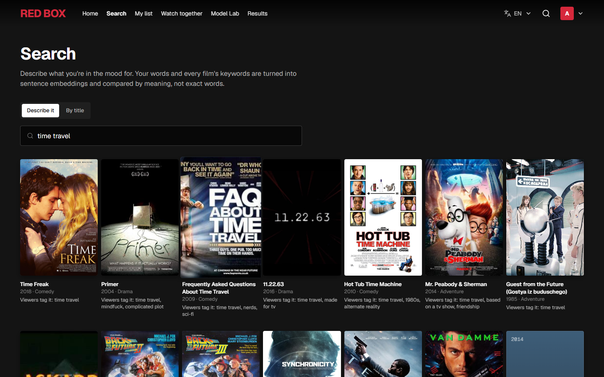
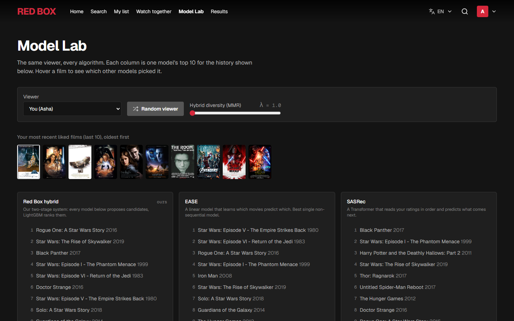
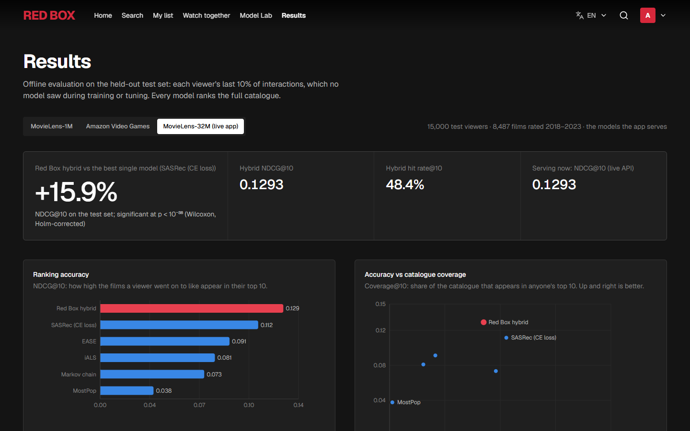

# Red Box: Collaborative Filtering for Personalized Movie/Product Recommendations

Red Box has three parts:
- **A comparison of 11 collaborative-filtering models**, from neighbourhood methods to graph neural networks
  and Transformers, on MovieLens-1M and Amazon Reviews 2023 (Video Games). All models share one leakage-free
  protocol and every result is logged.
- **Red Box**, our two-stage hybrid: multi-model candidates → LightGBM LambdaRank → MMR diversity.
- **A real web app.** Next.js talks to a FastAPI service that runs the hybrid in real time without
  PyTorch. It offers:
  - films up to 2023 (MovieLens-32M: 42,000 users, 8,500 films), with posters and summaries from Wikipedia,
    and new releases ever since (see below);
  - real accounts (hashed passwords, revocable tokens, rate-limited login, data export and deletion);
  - a start without rating: import a Netflix, IMDb or Letterboxd history, or get the models' cold-start picks;
  - explained recommendations, including "Why this pick?", the ranker's exact score split by signal (TreeSHAP);
  - natural-language search over each film's genres, viewer keywords and plot;
  - **new releases that keep coming:** films newer than the models' data (English and Hindi since 2023;
    Telugu, Tamil, Kannada and Malayalam since 2016) are found every day on Wikidata, recommended from their
    story at once (item cold start), and learn from every rating they get (collaborative topic regression);
    once enough people like one, retraining makes it a regular film in every model;
  - watch together: films for a group, with average, least-misery or most-pleasure strategies;
  - an online A/B test with live click-through metrics;
  - a Model Lab and a results dashboard;
  - English, Telugu and Hindi, and an installable phone app (PWA).

**Status:** Weeks 0–6 built and tested, then made production-grade (real accounts, online A/B testing,
recent catalogue, hardening).
- **Deployment:** the website is live at https://redbox-recommender.vercel.app. Its API runs on the
  author's laptop behind a free Cloudflare tunnel: `uv run --project backend python
  deploy/local/start_public.py` starts it and points the website at it. Always-on options (Google Cloud
  Run, a Hugging Face Space) are ready too. See [docs/DEPLOYMENT.md](docs/DEPLOYMENT.md).
- **Not in this repository:** datasets and trained bundles (MovieLens may not be redistributed; rebuild
  them with the commands below), and the landing page's film stills, which are copyrighted: add your own
  in `frontend/public/hero/stills/` (listed in `frontend/src/lib/stills.ts`).

Plan: [docs/PROJECT_PLAN.md](docs/PROJECT_PLAN.md) · Report: [docs/report/](docs/report/)

## Headline results (test set, NDCG@10)

| | MovieLens-1M | Amazon Video Games |
|---|---:|---:|
| **Red Box hybrid (ours)** | **0.1790** | **0.0919** |
| SASRec (Transformer, CE loss) | 0.1643 | 0.0849 |
| EASE (best non-sequential model) | 0.0810 | 0.0706 |
| LightGCN (graph neural network) | 0.0736 | 0.0586 |

- **The hybrid beats the best single model on both datasets** (+9.0% and +8.3%, p < 10⁻²⁶).
- **A tuned linear model (EASE) beats every non-sequential deep model** on both datasets.
- **On MovieLens, sequential models profit from a rating-session artifact.**
  - 96% of test users continue the same rating session; for users who return days later, EASE wins.
  - SASRec trained on *shuffled* histories loses 61% of its NDCG@10 and falls below EASE.
  - On Amazon this artifact is absent.
- **The app's own models (MovieLens-32M, 2018–2023, 42,144 users, 8,487 films):**
  - The hybrid it serves scores NDCG@10 **0.1293**, against 0.1115 for SASRec on the same 15,000 test users
    (+16.0%, p = 1.3 × 10⁻⁸⁷, Wilcoxon with Holm correction).
  - 48% of those users find a film they went on to like in its top ten.
  - New releases nobody has rated (3,146 at build time: 980 English, 183 Hindi, 464 Telugu, 741 Tamil,
    290 Kannada, 488 Malayalam; more are added daily) are recommended from their story: text mapped to iALS
    factors finds a liked film in the top ten 18.9% of the time, against 5.0% for text similarity alone.
    Each rating then moves a film towards its real audience: with 30 likes it closes 44% of the gap to a
    fully trained film (NDCG@10 0.080 → 0.100, against 0.125).
  - Even the trending row and a brand-new user's first picks come from the models: an ML forecast beats
    popularity (trending NDCG@10 0.961 vs 0.537; new users find a liked film in the top ten 17.2% vs 10.3%).

Details: [docs/report/11_results.md](docs/report/11_results.md) and
[ml/notebooks/03_results.ipynb](ml/notebooks/03_results.ipynb).

## Screenshots

| Home feed (explained picks, diversity slider) | Search by description |
|---|---|
|  |  |
| **Model Lab** (every model side by side) | **Results dashboard** |
|  |  |

## Run the app locally

Requirements: Python 3.12, [uv](https://docs.astral.sh/uv/), Node.js 20+.

```bash
# API (demo auth, SQLite): http://127.0.0.1:8000/docs
cd backend && uv run uvicorn app.main:app

# Web app: http://localhost:3000
cd frontend && cp .env.example .env.local && npm install && npm run dev

# Optional end-to-end check of the running stack
python deploy/smoke_test.py --api http://127.0.0.1:8000 --web http://localhost:3000
```

The API needs the exported model bundle in `data/bundles/ml-1m` (see below).

## Reproduce the research

```bash
cd ml
uv sync                                   # dependencies (CPU-only PyTorch)
uv run recsys download ml-1m && uv run recsys prepare ml-1m && uv run recsys eda ml-1m
uv run recsys split -c ml-1m              # leakage-checked per-user chronological split
uv run recsys benchmark -c ml-1m          # default settings -> docs/results/ml-1m/default_hparams/
uv run recsys tune -c ml-1m               # Optuna on validation, equal budget -> configs/ml-1m-tuned.yaml
uv run recsys benchmark -c ml-1m-tuned    # tuned models -> docs/results/ml-1m/tuned/
uv run recsys hybrid -c ml-1m-tuned       # the Red Box hybrid (+ MMR diversity variants)
uv run recsys benchmark -c ml-1m-ablations   # SASRec order ablation
uv run recsys rating -c ml-1m             # rating prediction (RMSE/MAE)
uv run recsys download ml-32m             # (for viewer keywords and TMDB ids)
uv run recsys content ml-1m               # movie texts + MiniLM sentence embeddings (semantic search)
uv run recsys export -c ml-1m-tuned       # serving bundle for the API -> data/bundles/ml-1m
uv run pytest && uv run ruff check .      # tests, lint
```

The app's own models (MovieLens-32M, see also `ml/scripts/train_app_models.sh`):

```bash
uv run recsys wiki ml-32m                 # posters + summaries from Wikipedia (no key) -> wiki.parquet
uv run recsys content ml-32m --bundle ../data/bundles/ml-32m   # texts (genres, keywords, plot) + MiniLM
uv run recsys export -c ml-32m            # bundle, incl. the crowd forecast (trending, new users)
uv run recsys serving-eval -c ml-32m      # served hybrid vs its models, same users, Wilcoxon -> docs/results/ml-32m/serving/
uv run recsys forecast -c ml-32m          # rebuild + evaluate the crowd forecast -> docs/results/ml-32m/forecast/
uv run recsys newfilms -c ml-32m          # new releases, six languages, + their evaluation -> docs/results/ml-32m/newfilms/
```

Runs are identified by a hash of their exact settings. `benchmark` skips anything already run with
identical settings, and `report` rebuilds the tables from MLflow. To browse every run:

```bash
uv run mlflow ui --backend-store-uri "sqlite:///../mlruns/mlflow.db"
```

The same commands work for `amazon-videogames` (`recsys download/prepare amazon-videogames`, config
`amazon-videogames.yaml`).

## Deploy (free tiers)

Vercel (web) + Hugging Face Spaces (API, Docker) + Supabase (optional accounts and database). Step by step:
[docs/DEPLOYMENT.md](docs/DEPLOYMENT.md). The public Space ships the trained models but no MovieLens user
histories (licence).

## Repository layout

| Path | What's inside |
|---|---|
| `ml/src/recsys/data/` | Verified downloads (resumable), parsers (MovieLens, Amazon), shared schema, chronological split, TMDB metadata |
| `ml/src/recsys/eval/` | Metrics (accuracy and beyond-accuracy) and the shared full-ranking evaluator |
| `ml/src/recsys/models/` | 11 models behind one interface: MostPop, UserKNN, ItemKNN, EASE, Markov, BPR-MF, iALS, NeuMF, Mult-VAE, LightGCN, SASRec |
| `ml/src/recsys/tuning/` | Optuna search spaces and the equal-budget tuner |
| `ml/src/recsys/hybrid/` | Red Box: candidate generation, features, LightGBM ranker, MMR |
| `ml/src/recsys/content/` | Viewer keywords (ML-32M tags), movie texts, MiniLM sentence encoder via ONNX Runtime |
| `ml/src/recsys/serving/` | Torch-free scorers (incl. SASRec in NumPy), bundle export, recommendation engine |
| `ml/src/recsys/experiments/` | Configs, the shared protocol, MLflow tracking, report tables |
| `ml/src/recsys/analysis/` | EDA, significance tests, session/activity analysis, figures |
| `ml/configs/` | Experiment configs (`*-tuned.yaml` are generated by `recsys tune`) |
| `ml/notebooks/` | `01` EDA · `02` Week 1 baselines · `03` all results; sources in `notebooks/src/` |
| `backend/` | FastAPI service, 12 tests, Dockerfile |
| `frontend/` | Next.js web app (see [frontend/README.md](frontend/README.md)) |
| `supabase/migrations/` | Production database schema with row-level security |
| `deploy/` | Hugging Face Space builder, smoke test |
| `docs/report/` | Report chapters 1–13 (Abstract … References) |
| `docs/results/`, `docs/figures/` | Generated tables and figures |
| `data/`, `mlruns/` | Datasets, splits, models, bundles, MLflow and Optuna stores (git-ignored) |

## Data licences

- **MovieLens** data (ratings and tags) is © GroupLens Research, used under its research licence. It is
  **not redistributed** here: scripts download it from the official source and verify its checksum.
- **Amazon Reviews 2023:** Hou et al. (2024), McAuley Lab.
- **all-MiniLM-L6-v2:** sentence-transformers, Apache 2.0.
- **Posters and summaries** come from Wikipedia through Wikidata. The text is CC BY-SA and is credited in the
  app. The posters are the studios' artwork, shown by Wikipedia under a fair-use rationale: fine for this
  research demo, but a public deployment should switch to TMDB artwork.
- **Movie metadata, when enabled:** This product uses the TMDB API but is not endorsed or certified by TMDB.
