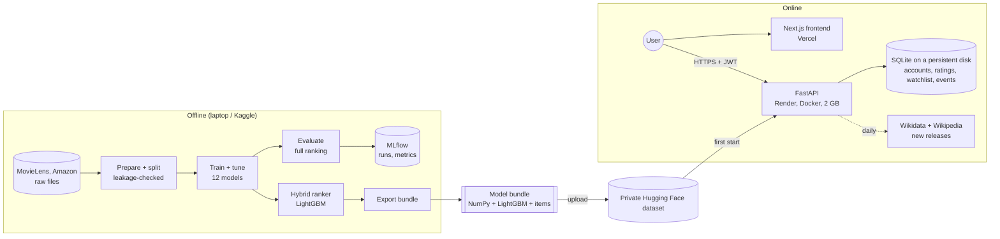
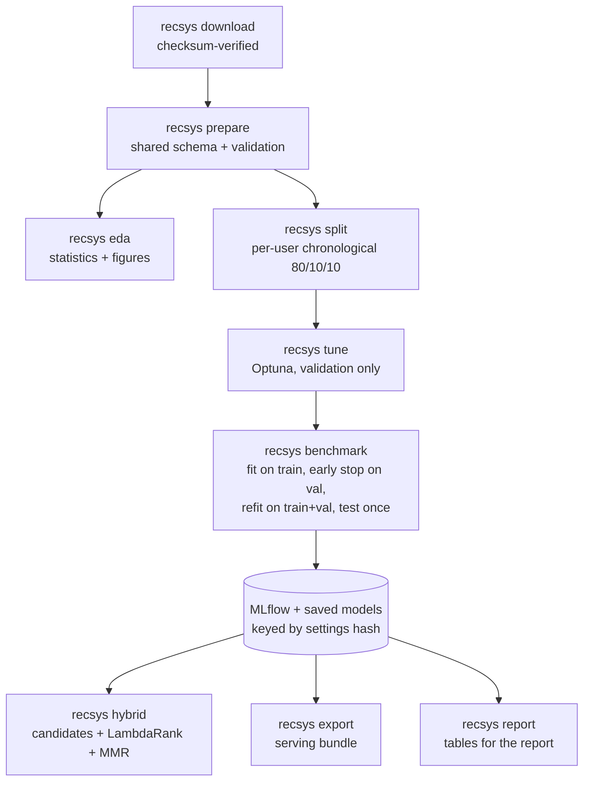
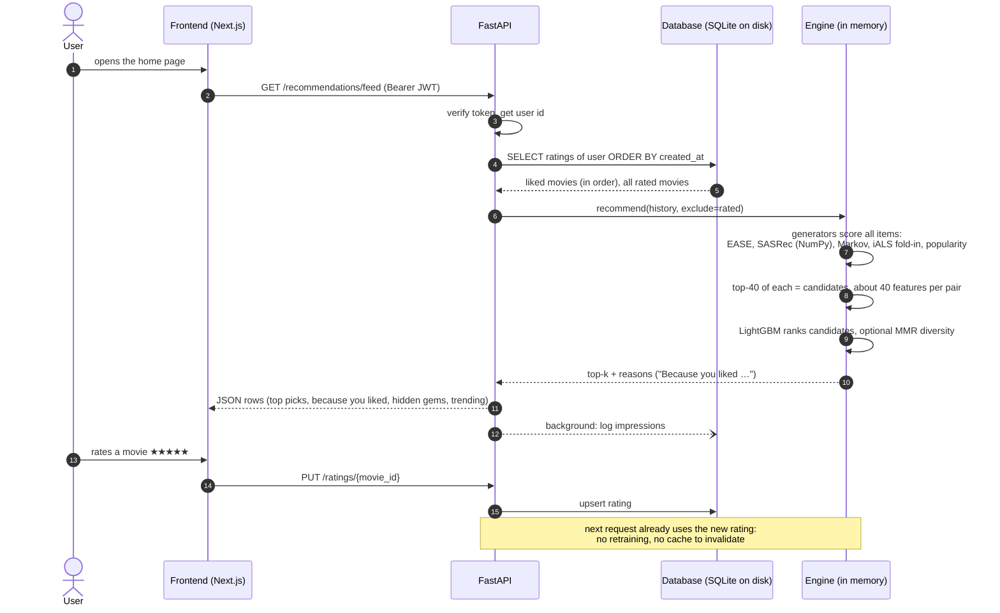
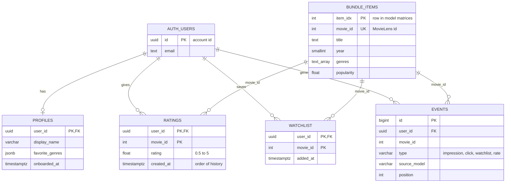
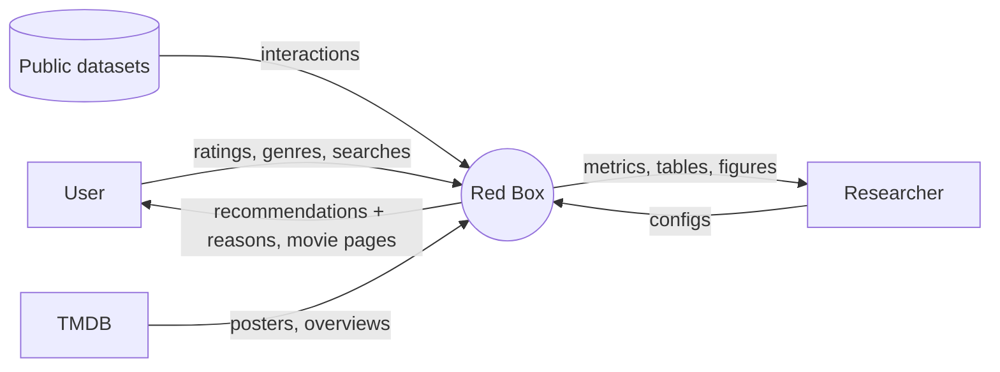
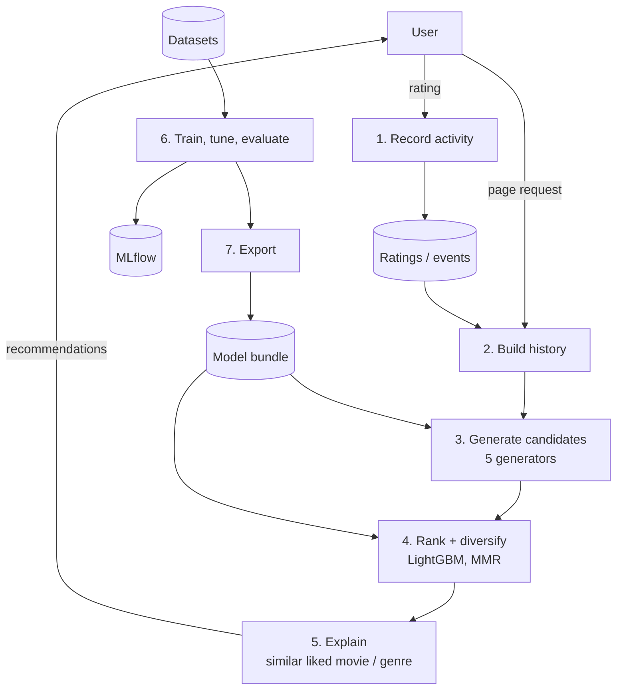
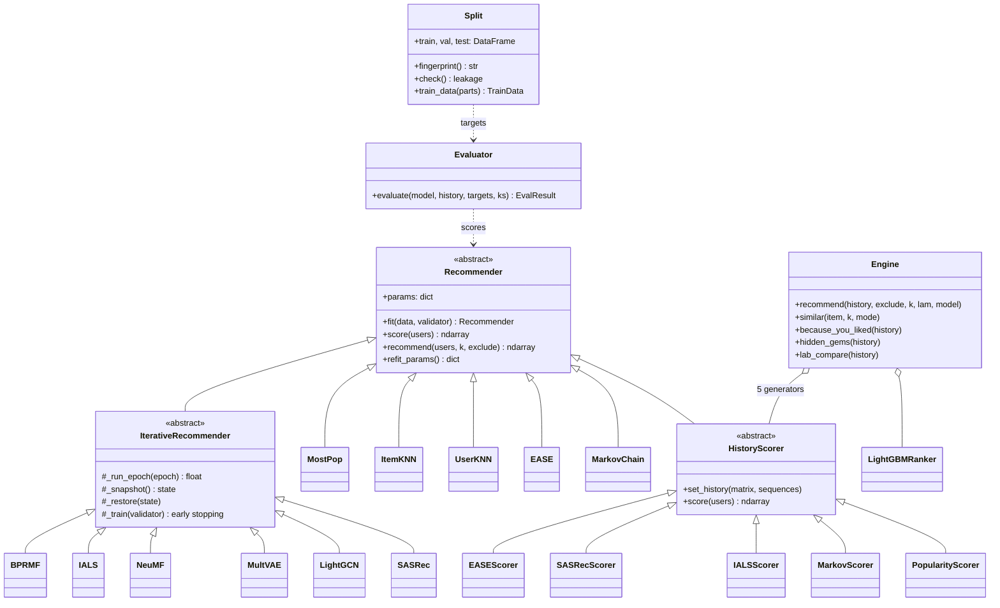
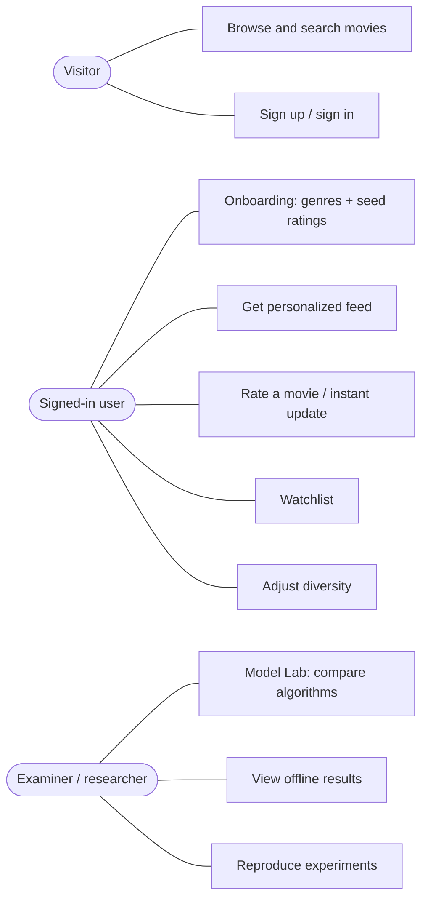
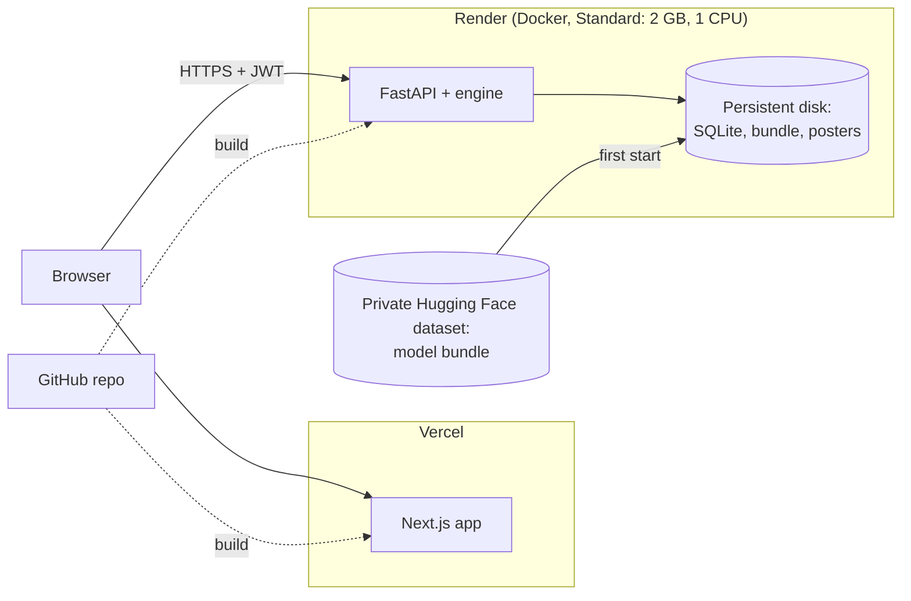

# Chapter 6: System Design

> Draft (Week 4). The diagrams are written in Mermaid: they render on GitHub, and can be exported as
> images for the report at https://mermaid.live.

---

## 6.1 Architecture overview

Red Box has two halves that meet in one artefact, the **model bundle**.

| Half | What it does | Where it runs |
|---|---|---|
| Offline research pipeline | trains and evaluates every model, then packs the deployed model into a bundle | laptop CPU or a Kaggle GPU |
| Online application | serves recommendations from the bundle and stores what users do | Vercel (website) and Render (API) |

---

## 6.2 Offline pipeline (Weeks 0–3)

**Reproducibility guarantees**
- Every split carries a fingerprint, a hash of its exact contents.
- Every run carries a settings hash, logged to MLflow.
- A run with identical settings is reused instead of being repeated.

---

## 6.3 Serving architecture: how a recommendation is made

The API never retrains. A request rebuilds the user's history from the database, and every generator
scores the catalog from that history.

**Latency budget (target: under 200 ms):**
- one EASE row product (3,458 × 3,458);
- one SASRec forward pass in NumPy (at most 200 positions);
- one 64 × 64 linear solve for iALS;
- LightGBM on about 150 rows.

---

## 6.4 Data model

The **movie catalog is part of the model bundle**, not the database. The catalog and the models can therefore never disagree, for example a movie that exists in the database but has no embedding. The database holds only user activity.

**Security:** row-level security on every table (`auth.uid() = user_id`) backs up the API's own checks (`supabase/migrations/`).

---

## 6.5 Data flow diagrams

**Level 0 (context)**

**Level 1**

---

## 6.6 Class diagram (core of the `recsys` package)

---

## 6.7 Use cases

---

## 6.8 Deployment

- **Live:** https://redbox-recommender.vercel.app, with the API at https://redbox-api.onrender.com.
- **Why this layout.** Hugging Face now charges for Docker Spaces, and free hosts without a card offer too
  little memory for the engine (about 1 GB), so the API runs on a paid Render Standard instance. Accounts live in
  SQLite on the service's persistent disk. Postgres (`supabase/migrations/`) remains supported.
- **The bundle** is too large for git and contains model weights derived from MovieLens, so it lives in a private
  Hugging Face dataset. `deploy/render/start.py` downloads it onto the disk on first start.

---

## 6.9 Key design decisions

| Decision | Alternative considered | Why |
|---|---|---|
| Catalog shipped inside the model bundle | catalog table in the database | the catalog always matches the models; no sync step |
| Torch-free serving: SASRec re-implemented in NumPy | PyTorch or ONNX Runtime in the API | small image and fast cold start on a free tier; a unit test proves identical outputs |
| Semantic search: MiniLM through ONNX Runtime, cosine over in-memory vectors | sentence-transformers (PyTorch); pgvector in the database | no PyTorch in the image; 3,458 × 384 vectors are 5 MB, so an in-memory dot product (~13 ms) beats a database round trip |
| Viewer keywords from MovieLens-32M tags as the movie text | TMDB overviews only | free and needs no API key; TMDB plots are added when a key is available |
| Public bundle ships aggregate item statistics, not user histories | publish the full bundle | the MovieLens licence forbids redistributing the ratings; a test shows recommendations are identical |
| Serving hybrid uses only history-based generators | the offline hybrid with LightGCN | new users and new ratings are handled instantly; LightGCN would need retraining |
| Serving ranker trained on features from the serving scorers | reuse the offline ranker | identical feature code for training and serving, so no train/serve skew |
| Recommendations recomputed per request | per-user cache | the next request always reflects the latest rating; computing is cheap (tens of ms) |
| Settings-hash caching of runs and models | rerun everything per report | hours of CPU training are never repeated for identical settings |
| Row-level security + API checks | API checks only | defence in depth if a client reaches the database directly |
