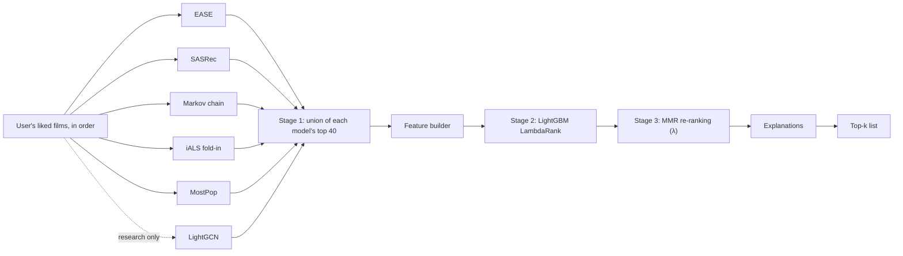

# Chapter 8: Proposed System: the Red Box Hybrid

The comparison in Chapter 11 shows that different models capture different signals:
- **EASE:** long-term taste.
- **SASRec and the Markov chain:** what comes next in a sequence.
- **iALS:** a smooth "taste space".
- **MostPop:** what everyone watches.

No single model is best for every user (Section 11.4). Red Box therefore combines them, following the
two-stage design used in industry (Covington et al., 2016), with a third stage for diversity.

---

## 8.1 Stage 1: candidate generation

- **Generators.** Each generator scores the whole catalogue for the user, and its top 40 unseen items become
  candidates. The generators overlap, so the union of the five deployed generators' lists is a median of
  123 films, not 200 (10th–90th percentile: 106–140; measured on 60 random MovieLens users).
- **Coverage of the targets.** On MovieLens test users, the candidate set contains 43.8% of the films the
  user actually liked next ("candidate recall", Section 11.5). This is the ceiling for any ranker on top.
- **Research hybrid:** six generators (EASE, SASRec with cross-entropy loss, Markov chain, iALS, LightGCN,
  MostPop).
- **Deployed hybrid:** only the five generators that can score a user from their *current* history without
  retraining. LightGCN is left out: a new user would need graph retraining. The deployed variant scores
  NDCG@10 = 0.1789 against 0.1790 for the research hybrid, so nothing is lost.

## 8.2 Stage 2: learning to rank

Every candidate (user, film) becomes one row of features. The deployed ranker uses 41:

| Group | Features | Why |
|---|---|---|
| Per generator (×5) | z-scored score, log rank, "in this model's top 40" | what each model thinks, on a comparable scale |
| Agreement | number of generators proposing the film | consensus |
| Popularity | log popularity; popularity relative to the user's usual taste | popular-vs-niche users |
| Sequence | item–item cosine similarity to the user's most recent liked film | short-term intent |
| Item | release year, 18 genre indicators | content and era |
| Taste match | cosine between the film's genres and the user's genre profile | genre affinity |
| User | log history length, mean popularity of the user's films | lets the ranker treat light and heavy users differently |

The research hybrid also has LightGCN's three features and, on MovieLens, three demographic attributes (47
features).

**Model.**
- LightGBM with the LambdaRank objective, which optimises NDCG directly over each user's candidate list.
- Settings: learning rate 0.05, 63 leaves, at least 100 rows per leaf.
- Early stopping on 15% of users held out from ranker training.

**No leakage.** The ranker must learn from data the generators did not see:
1. Generators are fitted on the *training* period.
2. The ranker is trained to put the user's *validation-period* likes on top: the future, relative to the
   generators.
3. For the final test, the generators are refitted on train + validation and the trained ranker is applied
   once to the test period.

**What it learned** (gain importance, Section 11.5):
- SASRec's rank dominates (52%), followed by EASE's taste score.
- History length, release year and similarity to the last film come next.
- The ranker learns *when* to trust the sequential signal. For users who return after a long gap it ranks
  close to EASE, where SASRec alone falls behind.

## 8.3 Stage 3: diversity re-ranking (MMR)

Maximal Marginal Relevance (Carbonell & Goldstein, 1998) builds the final list greedily. At each step it
picks the candidate $i$ that maximises

$$\lambda\,\widehat{rel}_i \;-\; (1-\lambda)\,\max_{j \in S} \mathrm{sim}(i, j)$$

where:
- $\widehat{rel}_i$ is the ranker's score rescaled to $[0,1]$;
- $S$ is the set of films already chosen;
- $\mathrm{sim}$ is the Jaccard similarity of the two films' genres.

With $\lambda = 1$ the ranker's order is kept. Smaller $\lambda$ trades a little accuracy for more variety:
at $\lambda = 0.8$, NDCG@10 drops by 4% and intra-list diversity rises by 16% (Section 11.5). The web app
exposes this as a "Diversity" slider.

## 8.4 Explanations

Every recommendation carries a one-line reason. The first rule that applies is used:
1. **"Because you liked *X*"** applies when one of the user's liked films is among the recommended film's
   collaborative neighbours (item–item cosine ≥ 0.1). The most similar such film is named.
2. **"Matches your taste for *genre*"** applies when the film shares a genre with the user's profile. The
   user's strongest such genre is named.
3. **"Popular with viewers who like what you like"** is the fallback.

A brand-new user sees "Predicted for viewers who like *genres*", from the crowd forecast (Section 8.5).

**"Why this pick?": the ranker's own account.** The one-line reason is a readable rule. The film page also
shows how the LightGBM ranker actually scored the film for this user.
- **What is computed:** TreeSHAP contributions (LightGBM's `pred_contrib`). Each of the 41 features gets an
  exact share of the score, and the shares add up to the score itself.
- **How it is grouped:** the 41 features are summed into the signal they come from:
  - SASRec (watch order);
  - EASE (films liked together);
  - iALS (taste factors);
  - the Markov chain;
  - popularity;
  - the user's genre taste;
  - similarity to the last film;
  - release year;
  - history length.
- **What the user sees:** signed shares (for example, SASRec +58%, EASE +30%, popularity −4%), the film's
  rank among the user's candidates, and the generators that proposed it.
- **Why it matters:** this is a faithful explanation of the model, not a separate rule. It is computed
  per request, in about 90 ms (`Engine.why`, `GET /recommendations/why/{id}`).

## 8.5 Real-time personalisation and cold start

- **No per-user model state.** Each generator scores a user from the history alone:
  - EASE multiplies the history by its item–item matrix;
  - SASRec runs its Transformer over the sequence;
  - the Markov chain reads the last film;
  - iALS solves one least-squares step for the user vector (*fold-in*), exactly the update used in training.

  A new rating is therefore reflected in the very next request, about 35 ms on a laptop.
- **New users: onboarding.**
  - The user picks favourite genres, then rates seed films.
  - Seeds are chosen to be *well known and divisive*, ranked by $\log(1+n_i)\cdot\sigma_i$ (number of
    ratings × rating spread), because such ratings tell us most about taste. Chosen genres come first.
  - After three ratings the user can continue; ten give good recommendations.
- **New users: importing a watch history instead.** A user can skip rating altogether by uploading the
  history another service lets them download (`backend/app/history_import.py`).
  - **Sources:**
    - Netflix "Viewing activity": titles and dates, no ratings;
    - IMDb exports: star ratings, matched exactly by IMDb id;
    - Letterboxd's export: ratings, diary, watched films and watchlist.
  - **Matching:** titles are matched to the catalogue by a normalised title, then by an alternative title,
    then a small fuzzy step (a near-identical title, or one that only adds a couple of words). A year, or
    the viewing date, separates remakes. TV episodes and very short views are left out.
  - **The user decides:** they see every match first and untick wrong ones. The file is never stored.
  - **How it feeds the models:** star ratings become ratings. A viewing becomes *implicit feedback*:
    counted as liked unless the user later rates the film below the threshold.
  - **Order is kept:** imported films keep their original dates, so the sequential models see them in the
    order they were watched.
  - **The trade-off:** a viewing is weaker evidence than a rating, because people abandon films. The design
    accepts some noise in exchange for an instant, effort-free start, and the review step and later
    ratings correct it.
- **New releases: item cold start, warm-up and graduation** (`ml/src/recsys/serving/newfilms.py`,
  `backend/app/releases.py`).
  - **The problem:** the models learned from MovieLens ratings, which end in October 2023, so nothing newer
    can be recommended. A film without ratings has no row in any collaborative model, so none can score
    it. This affects every new release, and nearly all recent South Indian films, which MovieLens barely
    covers.
  - **The idea:** the method of van den Oord et al. (2013), who predicted a music model's latent factors
    from audio. A ridge regression maps each film's MiniLM sentence embedding (year, genres, viewer
    keywords, Wikipedia summary) to its 64 iALS item factors. It is learned on the catalogue's films, and
    the ridge strength is chosen on held-out training films.
  - **New films:** films are taken from Wikidata by original language, with an English Wikipedia article,
    together with their posters and summaries: English and Hindi films released since 2023, and Telugu,
    Tamil, Kannada and Malayalam films since 2016. Only films already released count. English has about
    2,600 films a year on Wikidata, so only those covered by at least 8 Wikipedia language editions are
    kept (about 1,000). That count is also each film's measure of how widely known it is. Their factors are
    predicted from text. A bilingual release is kept once, under its first language.
  - **Checking the data:** a film's Wikidata link sometimes leads to an article about something else: a
    shelved film's article becomes a redirect to its lead actor, its studio or a list of films, and a
    sequel's to the original. The summary's opening must call the subject a film (not a person or a
    series), and not an older one; two links to one article keep the title the article uses. This left
    out 38 of 2,029 films, whose text, poster and recommendation would all have been wrong.
  - **Ranking:** a new film's factors are scored against the user's exact iALS vector (fold-in), the same
    way a known film's factors are. The result is shown as its own row ("New releases for you"), for all
    six languages together or for one picked with a filter. A brand-new user, with no history yet, gets
    the most widely known releases, those in the genres they picked first.
  - **Arrival, every day:** the API asks Wikidata for this year's and last year's releases in the six
    languages and adds the ones it doesn't have, with the same checks, embedding and mapping, while it
    runs (no restart, no retraining). They are saved into the bundle, so a restart keeps them.
  - **Warm-up with every rating:** the story only gives a first guess. Once app users rate a new film, its
    factors are re-estimated as in collaborative topic regression (Wang & Blei, 2011): the text's
    prediction is a Gaussian prior, and each rating is an iALS observation of the rater's taste vector.

        q = (c * sum_u p_u p_u^T + lambda * I)^-1 (c * sum_u r_u p_u + lambda * q_text)

    where p_u are the raters' iALS vectors, r_u is 1 for a like and 0 for a low rating, and c = 1 + alpha
    is iALS's confidence. With no ratings, q is the story's guess; the more people rate the film, the more
    its factors reflect who actually likes it. The prior strength lambda is chosen on validation data.
  - **Graduation:** once enough app users like a new film to pass the catalogue's own filter (20 likes),
    retraining with the app's ratings makes it a regular film: the data loader gives it its title, year
    and genres from the new-film tables, and every model learns it.
  - **Serving:** new films are appended after the models' films. They can be searched, rated and found by
    "similar story", but no generator scores them, and ratings on them do not enter the collaborative
    history until they graduate.
  - **Results:** Sections 11.14 and 11.15 measure both steps on catalogue films treated as new.
- **Watch together: recommendations for a group** (`Engine.group`, `POST /group`).
  - **Members:** the signed-in user and up to five friends, each described by a few films they love.
  - **A shared pool:** every member's hybrid candidates are pooled, and the ranker scores the whole pool for
    each member. The builder adds the pooled films to each member's candidate set, so all fits are about
    the same films.
  - **Fair weighting:** each member's scores are rescaled to 0–1 within the pool, so everyone counts the same.
  - **Three standard aggregation strategies** (Masthoff, 2011):
    - *average*: the most satisfaction overall;
    - *least misery*: a film is as good as its least happy member's fit;
    - *most pleasure*: as good as the happiest member's fit.
  - **Display:** each pick shows its fit for every member.
- **Zero history, and the trending row: an ML forecast instead of popularity** (`ml/src/recsys/serving/forecast.py`).
  - **The idea:** the hybrid is run for 4,000 dataset viewers, and each one's top 10 is added into one score
    per film, using the NDCG discount. The result says what *many viewers are predicted to watch next*,
    not what most viewers have already watched.
  - **The same sum, weighted by genre:** each viewer is weighted by how well their genre taste matches a
    set of genres. A brand-new user who picked genres at sign-up gets the forecast for "viewers like you";
    a user who picked none gets the overall forecast.
  - **Where it is used:** the trending row is the overall forecast, and every list now comes from the
    models, even before a first rating.
  - **Privacy:** the bundle stores only the per-film scores (`forecast.npz`), no viewer's history.
  - **The evidence:** it beats popularity clearly (Section 11.13).

## 8.6 The content side: keywords, semantic search and similar films

Collaborative filtering knows nothing about what a film is *about*. A small content layer adds that.

1. **Viewer keywords.** MovieLens-32M contains free-text tags written by users ("time travel",
   "dystopia", "mind-bending").
   - MovieLens ids are stable across releases, so the tags attach directly to the ML-1M films.
   - For each film, we keep up to 12 tags used by at least two different people (stop tags such as
     "seen it" or "dvd" are removed). 3,327 of the 3,458 films get keywords.
2. **Film texts and embeddings.**
   - Each film becomes one sentence: title, year, genres, keywords, plus the TMDB plot when available.
   - The sentence is embedded with all-MiniLM-L6-v2 (384 dimensions), run through ONNX Runtime with mean
     pooling and L2 normalisation, so the API needs no PyTorch.
   - The model files are pinned to a repository revision and verified by SHA-256.
3. **Semantic search.**
   - A query such as "feel-good animated film for kids" is embedded the same way and compared with every
     film by cosine similarity: 3,458 dot products, about 13 ms.
   - A small popularity prior (weight 0.05) breaks near-ties in favour of films people know.
   - Results explain themselves with the keywords that match the query.
4. **Similar films** are shown two ways:
   - **"Liked by the same viewers":** collaborative, item–item cosine.
   - **"Similar story and themes":** cosine between text embeddings. For *The Matrix* this gives *Dark
     City*, *The Thirteenth Floor* and *Gattaca*.
5. **Hidden gems.** These are well-rated films (mean rating ≥ 3.7) outside the most-watched quarter.
   - They are ranked by EASE plus the cosine between each film's embedding and the user's mean liked-film
     embedding, both standardised.
   - CF scores alone are noisy for rarely watched films; the content profile steadies them.

## 8.7 Why this design

| Choice | Alternative | Reason |
|---|---|---|
| Two-stage hybrid | a single best model | different models win for different users; a ranker learns when to trust which (+9.0% / +8.3%) |
| LambdaRank on validation labels | averaging model scores | learns weights per situation (history length, recency) and stays leakage-free |
| MMR with a user-facing λ | fixed diversity | the right accuracy–variety balance is personal; Section 11.5 quantifies it |
| History-only generators in the app | include LightGCN | instant updates for new users at no measured accuracy cost |
| Viewer keywords + MiniLM via ONNX | TMDB-only text, or a PyTorch encoder | free, available without any API key, and keeps the server image small |
